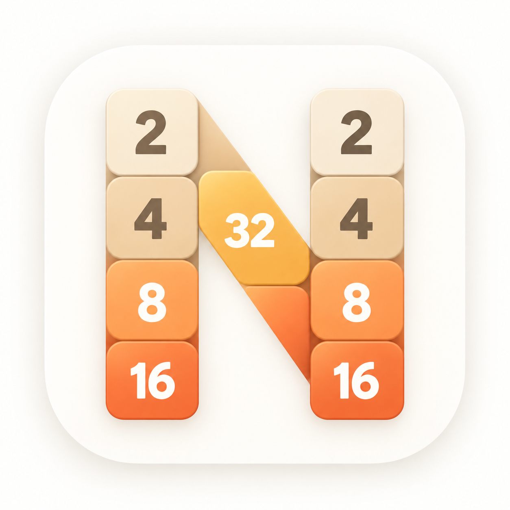
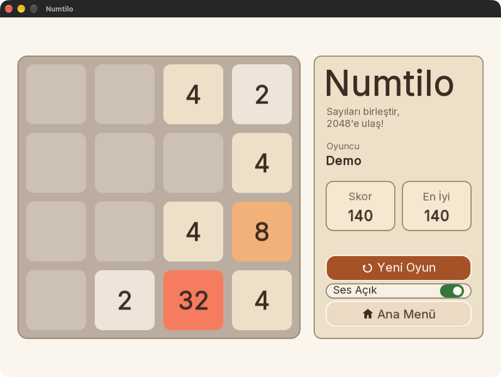
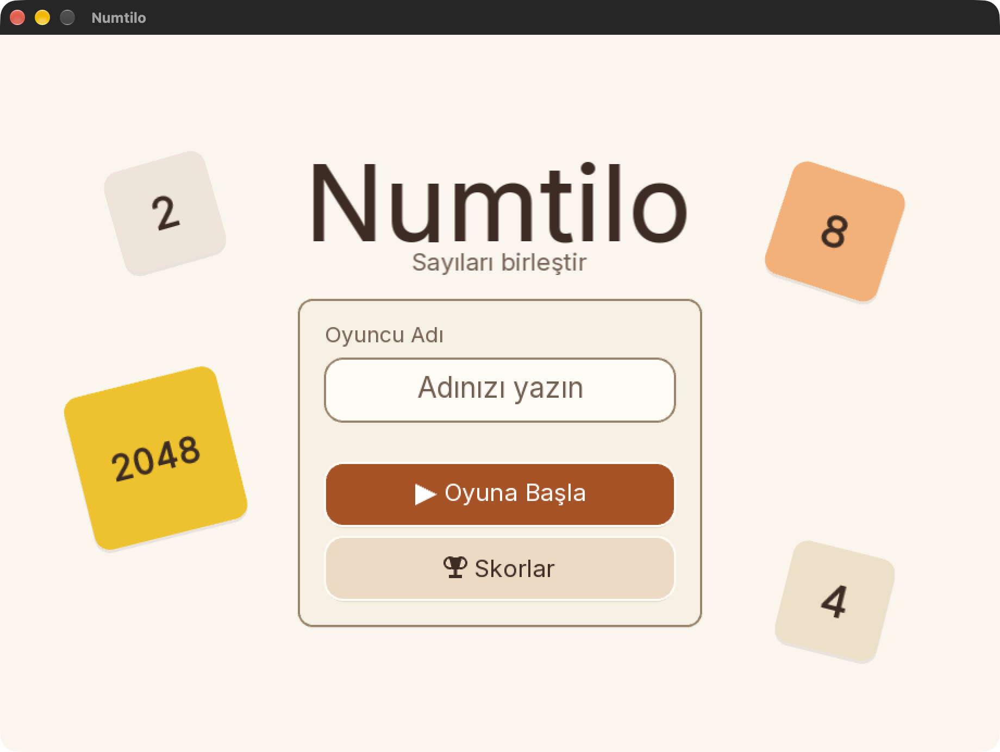
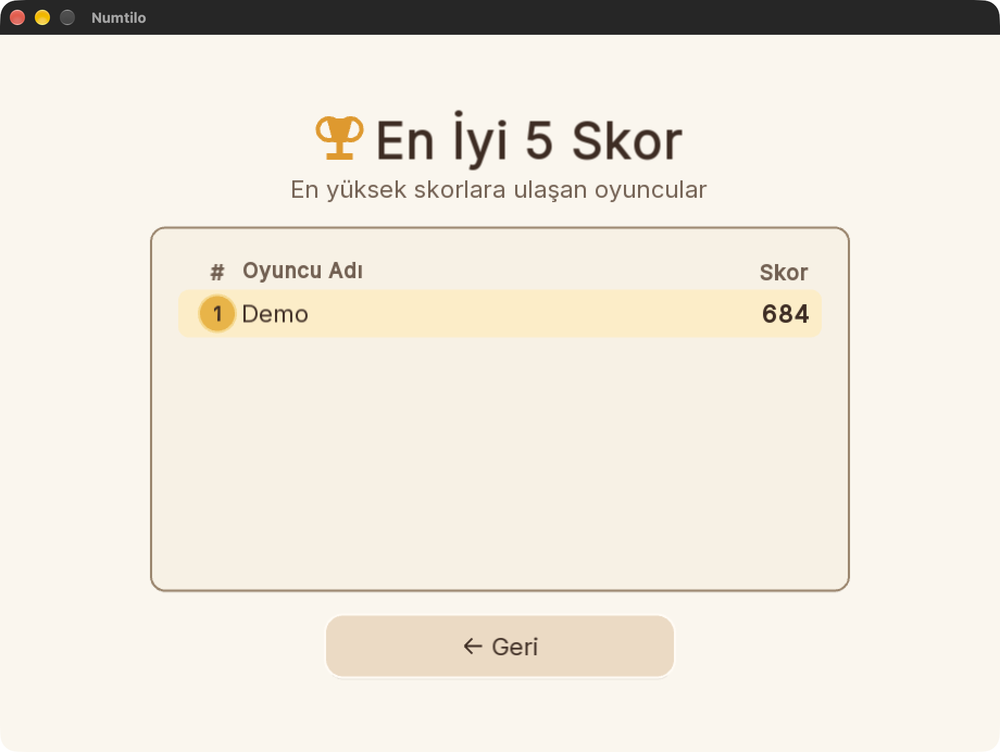

[English](README.md) | [Türkçe](README.tr.md)

<p align="center">
  
</p>

# Numtilo

Numtilo, C++20 ve SFML ile geliştirilen, Türkçe arayüzlü bir masaüstü 2048 bulmaca
oyunudur. Eşit değerli karoları kaydırarak birleştirin, puan kazanın ve 2048'e ulaşın.

<p align="center">
  
</p>

Güncel yayın: **[v0.2.2](https://github.com/EnesGoker/Numtilo/releases/tag/v0.2.2)**.

## İndir ve oyna

**Oynamak için kaynak koddan derleme yapmanız gerekmez.** Platformunuza uygun ZIP'i
[v0.2.2 yayınından](https://github.com/EnesGoker/Numtilo/releases/tag/v0.2.2) indirin.
Bunlar kurulum programı değil, ZIP arşivleridir. Uygulamayı açmadan önce arşivin
tamamını çıkarın; paketle gelen asset ve kütüphaneleri çıkarıldıkları konumlarda koruyun.

| Platform | İndir | Çıkardıktan sonra çalıştırma |
| --- | --- | --- |
| macOS ARM64 (Apple Silicon) | [macOS ZIP](https://github.com/EnesGoker/Numtilo/releases/download/v0.2.2/Numtilo-0.2.2-darwin-arm64.zip) | Finder'da `Numtilo.app` dosyasını açın. |
| Windows x64 | [Windows ZIP](https://github.com/EnesGoker/Numtilo/releases/download/v0.2.2/Numtilo-windows-latest.zip) | `Numtilo.exe` dosyasını açın; ayrıca bir konsol penceresi açılır. |
| Linux x86_64 | [Linux ZIP](https://github.com/EnesGoker/Numtilo/releases/download/v0.2.2/Numtilo-0.2.2-linux-x86_64.zip) | Çıkarılan klasörde `./numtilo` çalıştırın; gerekirse önce `chmod +x numtilo` kullanın. |

macOS paketinde Developer ID imzası ve Apple noter onayı yoktur; macOS güvenlik
kontrolleri internetten indirilen kopyayı engelleyebilir. Sanal makinedeki manuel
sonuçlar ve otomatik kontroller her bilgisayar veya dağıtımla uyumluluk garantisi vermez.

## Özellikler

- 4×4 tahta, birleşmelerden kazanılan puanlar ve 2048'e ulaştıktan sonra oyuna devam etme.
- Oyuncu adları, anlık güncellenen en yüksek skor ve tamamlanmış oyun geçmişinden en iyi beş skor.
- Karo animasyonları ve beş ses efekti; kalıcı ses açma/kapama tercihi.
- Yerel skor/ayar profilleri ve eski `sfml-2048` profilinden güvenlik kontrolleriyle veri aktarımı.

Aktif oyun tahtası kaydedilmez: uygulama yeniden açıldığında yeni bir oyun başlar;
yarım kalan oyuna devam edilemez. Kayıt ve profil geçişi ayrıntıları için
[mimari belgesine](docs/architecture.md) bakın.

<details>
<summary>Ana menü ve tamamlanmış oyunların skorları</summary>

<p align="center">
  
</p>

Aşağıdaki skor tablosu, gerçek kullanıcı verisi yerine izole Demo profilinde tamamlanmış bir oyunu gösterir.

<p align="center">
  
</p>

</details>

## Kontroller

| Bağlam | Kontroller |
| --- | --- |
| Oyuncu adı | Yazma veya Backspace; Enter adı doğrular ve oyunu başlatır |
| Oyun sırasında | Yön tuşları karoları hareket ettirir; N yeni tur başlatır; Esc menüye döner |
| Kontrol odağı | Tab / Shift+Tab odağı taşır; Enter / Space, tuş bırakıldığında odaktaki eylemi etkinleştirir |
| Kazanma paneli | Esc oyuna devam eder; Tab, Enter / Space ile etkinleştirilecek eylemi seçer |
| Oyun Bitti | N veya hiçbir kontrol odakta değilken Enter yeniden başlatır; Esc menüye döner |
| Skor Tablosu | Esc / Q / Backspace menüye döner |

Oyun sırasında hiçbir kontrol veya erişilebilir oyun tahtası odakta değilken Enter yeni tur başlatır.
Fare tıklamaları kontrolleri çalıştırır; pencereyi kapatma düğmesi uygulamadan çıkarır. WASD desteği yoktur.

## Kaynak koddan derleme ve çalıştırma (isteğe bağlı)

Aşağıdaki vcpkg yöntemi için **Git**, **CMake 3.24+**, bir **C++20 derleyicisi** ve
bu kaynak ağacı dışında bir [vcpkg](https://github.com/microsoft/vcpkg) kopyası gerekir.
macOS'ta Xcode Command Line Tools; Windows'ta C++ araçlarıyla Visual Studio 2022 ve
Developer PowerShell kullanın. Linux'ta ayrıca grafik/ses geliştirme paketleri gerekir;
[CI'ın Ubuntu kurulumu](.github/workflows/ci.yml) bir örnek sunar.

Komutları proje kökünde çalıştırın. vcpkg'yi bir kez hazırlayın, `VCPKG_ROOT` değerini
mutlak yoluyla ayarlayın ve yapılandırma, derleme ve test boyunca koruyun. Bağımlılıkların
ilk edinimi internet erişimi gerektirebilir. Komutlar yeni Numtilo derleme dizinleri
içindir; ad geçişinden önceki önbellekleri ve doğrulama kanıtlarını koruyun.

### macOS / Linux

```bash
export VCPKG_ROOT="/absolute/path/to/vcpkg"
"$VCPKG_ROOT/bootstrap-vcpkg.sh"
cmake --preset vcpkg-debug
cmake --build --preset build-vcpkg-debug
```

macOS'ta çalıştırma:

```bash
open build/vcpkg-debug/Numtilo.app
```

Linux'ta çalıştırma:

```bash
./build/vcpkg-debug/numtilo
```

### Windows

```powershell
$env:VCPKG_ROOT = 'C:\path\to\vcpkg'
& "$env:VCPKG_ROOT\bootstrap-vcpkg.bat"
cmake --preset vcpkg-debug -G "Visual Studio 17 2022" -A x64
cmake --build --preset build-vcpkg-debug --config Debug
.\build\vcpkg-debug\Debug\Numtilo.exe
```

[Derleme sözleşmesi](docs/build-contract.md), sistem bağımlılıklarını, Release
preset'lerini ve `NUMTILO_*` seçeneklerini açıklar. vcpkg manifesti SFML sürümünü 2.6.2'ye sabitler.

Komut satırı seçenekleri için çalıştırılabilir dosyayı `--help` ile çağırın.
`--check-runtime`, pencere açmadan veya skor/ayar yüklemeden paketlenmiş fontu, ikon
PNG'sini ve beş WAV dosyasını okur. Kod çözme, çizim, ses çalma veya kaydetme
izinlerini test etmez.

## Platform durumu

- **macOS ARM64:** kullanıcı, v0.2.2 ZIP'ini sanal makinede elle kontrol ettiğini ve
  uygun bulduğunu bildirdi. Developer ID imzası ve Apple noter onayı sağlanmıyor.
- **Windows x64:** kullanıcı, v0.2.2 ZIP'ini sanal makinede elle kontrol ettiğini ve
  uygun bulduğunu bildirdi. Oyunla birlikte konsol penceresi açılıyor.
- **Linux x86_64:** kullanıcı, v0.2.2 ZIP'ini sanal makinede elle kontrol ettiğini ve
  uygun bulduğunu bildirdi.

macOS VoiceOver bağdaştırıcısı uygulanmıştır; [tarihî erişilebilirlik kanıtları](docs/ui-quality-audit.md),
ad geçişi sonrasında tam bir GUI/VoiceOver doğrulaması yapıldığını göstermez.
Windows/Linux ekran okuyucu bağdaştırıcıları uygulanmamıştır. GitHub CI ve Release
iş akışları v0.2.1 için başarıyla tamamlandı. Yukarıdaki manuel sonuçlar kullanıcı beyanıdır.

## Testler

Grafik arayüzü gerektirmeyen Catch2/CTest birim testleri masaüstü uygulamasına ihtiyaç duymaz:

```bash
cmake --preset vcpkg-headless-debug
cmake --build --preset build-vcpkg-headless-debug
ctest --preset test-vcpkg-headless-debug
```

Masaüstü Debug derlemesi için; Python 3 mevcutsa platform kabul kontrolleri de dahildir:

```bash
ctest --test-dir build/vcpkg-debug -C Debug --output-on-failure
```

Sistem bağımlılıklarıyla çalışmaya yönelik komutlar, Release yapılandırmaları ve isteğe
bağlı grafik arayüz kabulü için [test belgesine](docs/testing.md) bakın.

## Belgeler

- [Mimari](docs/architecture.md) · [Derleme sözleşmesi](docs/build-contract.md)
- [Testler](docs/testing.md) · [Platform kabulü](docs/platform-acceptance.md)
- [Skor kalıcılığı kabulü](docs/score-persistence-acceptance.md)
- [Bakım](docs/maintenance.md) · [Değişiklik günlüğü](CHANGELOG.md)
- [Katkıda bulunma](CONTRIBUTING.md) · [Güvenlik](SECURITY.md)

## Lisans

Proje kodu: [MIT](LICENSE). [Üçüncü taraf bildirimlerine](THIRD_PARTY_NOTICES.md)
ve paketle birlikte gelen [Inter font lisansına](assets/fonts/LICENSE-Inter.txt) bakın.
Beş ses efekti, Kenney Interface Sounds 1.0 paketinden seçilmiştir ve CC0 1.0 kapsamındadır.
Kaynak ve lisans bilgileri [üçüncü taraf bildirimlerinde](THIRD_PARTY_NOTICES.md) kayıtlıdır.
